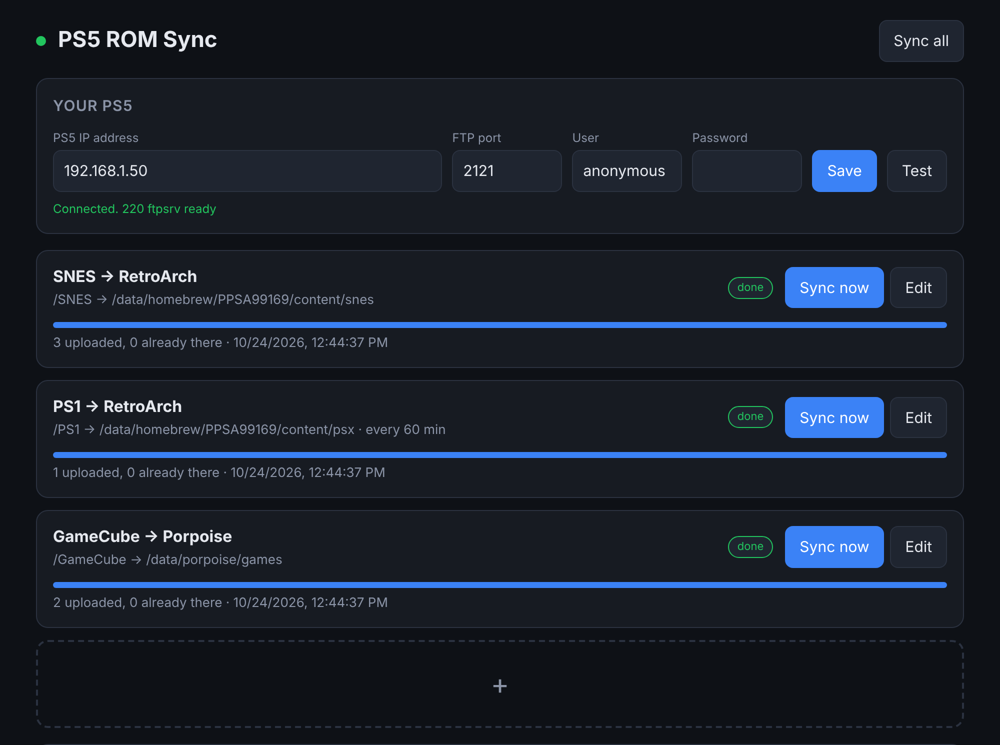
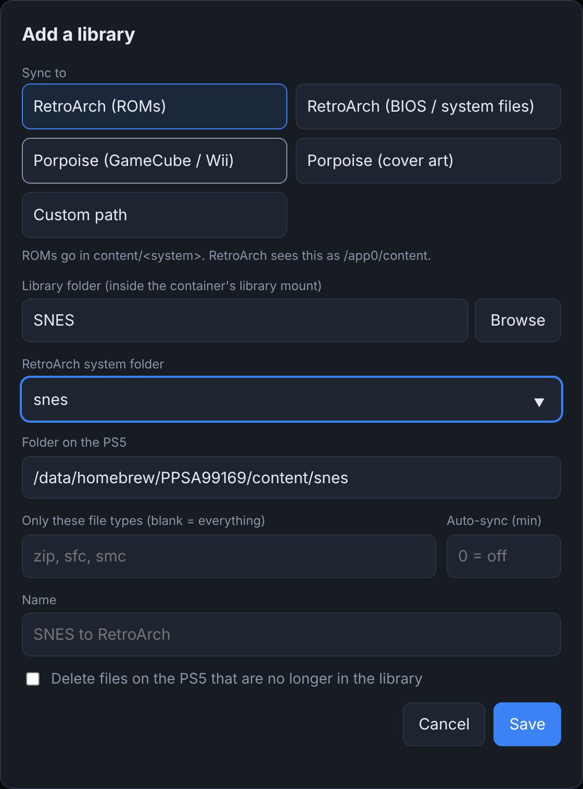

<div align="center">

# 🎮 PS5 ROM Sync

**Point it at your ROM folder, type in your PS5's IP, hit ➕, done.**

A tiny Docker container that copies your retro game library to a jailbroken PS5 over FTP, sorted into the exact folders that **RetroArch** and **Porpoise** look in.

[](https://github.com/ThatRetiredDude/ps5-rom-sync/actions/workflows/docker.yml)
[](https://github.com/ThatRetiredDude/ps5-rom-sync/pkgs/container/ps5-rom-sync)
[](LICENSE)
[](https://github.com/ThatRetiredDude/ps5-rom-sync/stargazers)




</div>

---

## ✨ What it does

- 🕹️ **RetroArch and Porpoise built in.** Pick a target and the right PS5 folder is filled in for you.
- ➕ **One card per sync.** SNES to RetroArch, GameCube to Porpoise, BIOS files, cover art, or any custom folder.
- ⚡ **Only copies what's new.** Files already on the PS5 with the same size are skipped, so re-syncs take seconds.
- 🛡️ **No half-copied ROMs.** Each file uploads as `name.part` and is renamed when it finishes.
- ⏰ **Auto-sync on a timer**, if you want it.
- 🧹 **Optional cleanup** of games you've removed from your library.
- 📱 **Works from your phone.** It's just a web page.

## 📂 Where your games end up

| Target | Folder on the PS5 | Good for |
|---|---|---|
| 🕹️ **RetroArch (ROMs)** | `/data/homebrew/PPSA99169/content/<system>` | NES, SNES, Genesis, GBA, PS1, N64, arcade… |
| 🧬 **RetroArch (BIOS)** | `/data/homebrew/PPSA99169/system` | BIOS files. PS2 BIOS goes in `system/pcsx2/bios`. |
| 🐬 **Porpoise (games)** | `/data/porpoise/games` | GameCube and Wii: `iso gcm rvz ciso gcz wbfs wia` |
| 🖼️ **Porpoise (covers)** | `/data/porpoise/covers` | Box art PNGs named by disc ID, like `GALE01.png` |
| 📁 **Custom** | anything you type | Other emulators and homebrew |

Paths come from the [PS5 RetroArch port](https://github.com/bigdaddydev805/PS5_RetroArch) and the [Porpoise README](https://github.com/elripalda/Porpoise-Dolphin-Emulator-for-PS5). You can edit any of them per sync if your setup is different.

---

## 🚀 Setup

### 1. Get an FTP server running on the PS5

Load one of these after jailbreaking:

| FTP server | Port |
|---|---|
| **ftpsrv** payload | `2121` (the default here) |
| **etaHEN** built-in FTP | `1337` |

Write down your PS5's IP address. You'll find it under **Settings → Network → Connection Status**.

> 💡 Give the PS5 a fixed IP (a DHCP reservation on your router) so you don't have to update it later.

### 2. Start the container

Make a folder for it and save this as `docker-compose.yml`. Change `/path/to/your/roms` to where your ROMs live.

```yaml
services:
  ps5-rom-sync:
    image: ghcr.io/thatretireddude/ps5-rom-sync:latest
    container_name: ps5-rom-sync
    ports:
      - "8585:8585"
    volumes:
      - ./config:/config
      - /path/to/your/roms:/roms:ro
    environment:
      - TZ=America/New_York
    restart: unless-stopped
```

Then run:

```sh
docker compose up -d
```

<details>
<summary>🐳 Plain <code>docker run</code> instead</summary>

```sh
docker run -d --name ps5-rom-sync \
  -p 8585:8585 \
  -v $PWD/config:/config \
  -v /path/to/your/roms:/roms:ro \
  --restart unless-stopped \
  ghcr.io/thatretireddude/ps5-rom-sync:latest
```
</details>

<details>
<summary>🛠️ Build it yourself</summary>

```sh
git clone https://github.com/ThatRetiredDude/ps5-rom-sync.git
cd ps5-rom-sync
docker build -t ps5-rom-sync .
```
Then use `image: ps5-rom-sync` in the compose file.
</details>

<details>
<summary>🟧 Unraid / Synology / TrueNAS</summary>

Add a container from `ghcr.io/thatretireddude/ps5-rom-sync:latest` with:
- Port `8585` → `8585`
- Path `/config` → somewhere in your appdata
- Path `/roms` → your ROM share (read-only is fine)
</details>

### 3. Connect to your PS5

Open **`http://<your-server-ip>:8585`**, type in the PS5's IP and FTP port, then hit **Save** and **Test**. The dot next to the title turns green when it can reach the PS5.

### 4. Add your libraries with ➕



**RetroArch:**
1. Hit **➕** and pick **RetroArch (ROMs)**.
2. **Browse** to a system folder in your library, like `SNES`.
3. Set **RetroArch system folder** to `snes`. It's guessed for you when your folder name matches.
4. Hit **Save**.

**Porpoise:**
1. Hit **➕** again and pick **Porpoise (GameCube / Wii)**.
2. **Browse** to your GameCube or Wii folder. Subfolders are fine; Porpoise looks four levels deep.
3. Hit **Save**.

**Anything else:** hit **➕** again and pick **Custom path**.

### 5. Sync

Hit **Sync now** on a card, or **Sync all** at the top. The progress bar and the activity log show what's happening. Next time, only new or changed files are copied.

<br clear="right">

---

## ⚙️ Options per sync

| Option | What it does |
|---|---|
| **Only these file types** | Comma-separated extensions, like `sfc, smc, zip`. Blank copies everything. |
| **Auto-sync (min)** | Re-sync every N minutes. `0` turns it off. |
| **Delete files on the PS5…** | Removes files from the PS5 folder that aren't in your library anymore. Only touches files of the chosen types, only inside that sync's folder. Off by default. |

## 🔧 Environment variables

| Variable | Default | What it does |
|---|---|---|
| `WEB_PORT` | `8585` | Port for the web page |
| `PS5_HOST` | blank | Pre-fills the PS5 IP |
| `PS5_FTP_PORT` | `2121` | Pre-fills the FTP port |
| `LIBRARY_ROOT` | `/roms` | Where the library is mounted inside the container |
| `CONFIG_DIR` | `/config` | Where `config.json` is saved |

## 🩺 Troubleshooting

<details>
<summary><b>"Could not connect" when I hit Test</b></summary>

- Make sure the FTP payload is actually running. It stops when the PS5 goes into rest mode or reboots.
- Double-check the port: `2121` for ftpsrv, `1337` for etaHEN.
- The server running Docker has to be on the same network as the PS5.
</details>

<details>
<summary><b>Games copied but RetroArch doesn't show them</b></summary>

In RetroArch, use **Import Content → Scan Directory** and pick `/app0/content/<system>`. That's the same folder as `/data/homebrew/PPSA99169/content/<system>` on the PS5.
</details>

<details>
<summary><b>Porpoise doesn't show my games</b></summary>

Check the file type. Porpoise reads `iso gcm rvz ciso gcz wbfs wia`. Zipped or 7z'd games need to be extracted first.
</details>

<details>
<summary><b>Syncing is slow</b></summary>

Use a wired connection on the PS5 if you can. Syncs run one at a time on purpose, because PS5 FTP servers get unhappy with several uploads at once.
</details>

<details>
<summary><b>My library folder is empty in Browse</b></summary>

The `/roms` volume isn't mounted, or it points somewhere else. Check the `volumes:` line in your compose file.
</details>

## 🧑‍💻 Development

```sh
pip install -r requirements-dev.txt
python -m pytest -q                      # tests run against a local fake FTP server
CONFIG_DIR=./config LIBRARY_ROOT=/path/to/roms python -m app.main
```

## 📜 License

[MIT](LICENSE). Bring your own legally dumped games. 🙏

<div align="center">
<sub>Not affiliated with Sony, RetroArch, or the Porpoise project.</sub>
</div>
